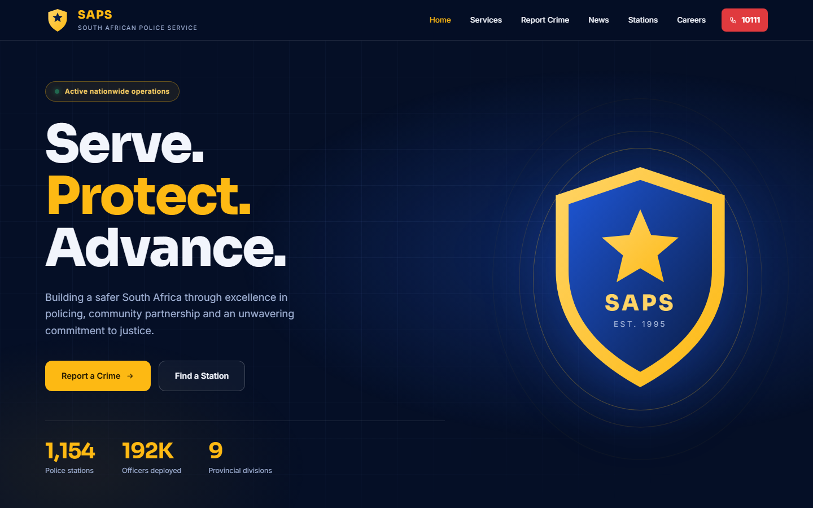
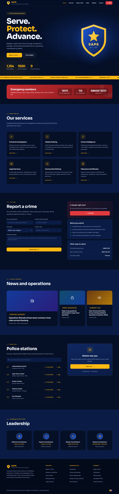
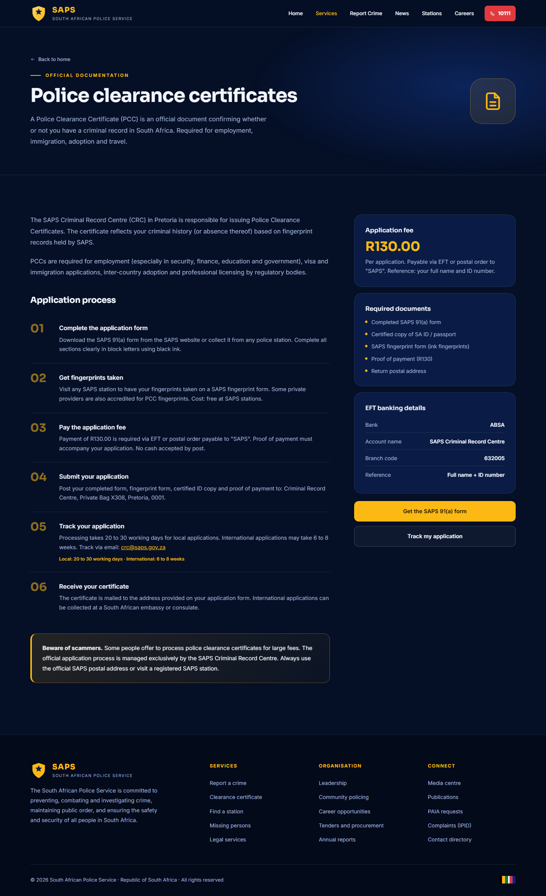
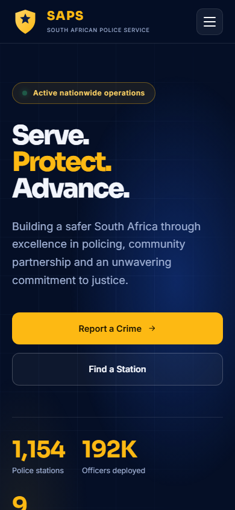

# SAPS Website Rewrite

A modern, fully working rewrite of the South African Police Service (SAPS) website concept. It is a single self-contained file, `index.html`, with no build step. The only external resource is Google Fonts.

Open `index.html` in any browser to view it. Pages use hash links (for example `index.html#careers`), so the browser back button and direct links work.

## Preview

### Desktop

Full home page

Careers page

Police clearance certificate page

### Mobile

Full mobile home page

## Design

- **Fonts:** [Sora](https://fonts.google.com/specimen/Sora) for headings and [Inter](https://fonts.google.com/specimen/Inter) for body text, replacing Bebas Neue, Playfair Display and DM Sans.
- **Colours:** SAPS blue and gold, with police emergency red and the green used for confirmations. The shield emblem is now an inline SVG in the same palette.
- **Icons:** The emoji were replaced with a consistent inline SVG icon set.

## What works

- **Routing:** Eight pages (Home, Careers, Criminal Investigation, Visible Policing, Crime Intelligence, Legal Services, Community Policing, Clearance Certificates) run on hash routing. The page title updates per page and the nav highlights the current section.
- **Mobile:** Hamburger menu, stacked layouts and a horizontally scrollable vacancies table.
- **Report a crime:** Validated form with a confidence-building checklist, an emergency call-out and a demo reference number on success. Nothing is sent.
- **Station finder:** Live search across stations, tap-to-call numbers and per-station map links.
- **Vacancies:** Search plus division and province filters, a results count and an Apply dialog. Clicking a division card on the careers page pre-filters the table.
- **News:** Cards open a summary dialog.
- **Emergency numbers:** All numbers are tap-to-call (`tel:`) links, and the Crime Stop number is now shown in full (08600 10111).
- **Accessibility:** Skip link, focus styles, labelled form fields, ARIA attributes, keyboard-closable dialogs and `prefers-reduced-motion` support.
- **Clean-up:** All em dashes and en dashes removed from the copy and title. Station counts are consistent at 1,154.

## Notes

- Vacancies, news summaries and station phone numbers come from the original concept and are illustrative. Always confirm real details on the official SAPS website.
- Links without a matching page here (tenders, annual reports, PAIA and similar) and the application buttons point to the official SAPS and DPSA websites.
- The report form is a front-end demo. In an emergency call **10111**.

## License

Released under the [MIT License](LICENSE).
